

  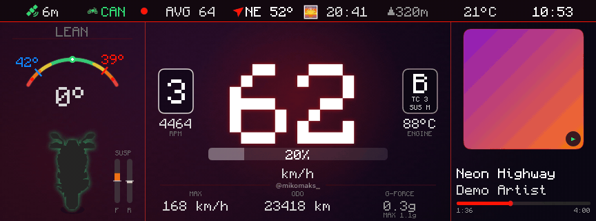

<h1 align="center">SpinMyCan</h1>

  <b>Your own dashboard on the Suzuki GSX-S1000GX color TFT — straight from your iPhone.</b> 
  Lean angle, speed, navigation, music, ride recording… and with the optional CAN board also
  RPM, gear, riding and suspension modes, temperatures and odometer right from the bike's bus.

  
  
  
  
  

<a href="README.pl.md">🇵🇱 Polska wersja</a>

> [!NOTE]
> An independent hobby project — **not affiliated with Robert Bosch GmbH (mySPIN) or Suzuki**,
> and not endorsed by them. Their names are used only to describe what the project works with.
> All images in this README are rendered by the app from **demo data**.
> The app's user interface and code comments are in Polish.

---

## 📱 Just your phone is enough

**The CAN board is an add-on, not a requirement.** Without it the app is fully featured: speed
comes from GPS, lean angle and g-force from the phone's sensors in the handlebar mount (with
calibration), and everything else — navigation, music, ride recording, video, games — the app
does on its own. The board adds what the phone can't know: RPM, gear, throttle, modes,
temperatures, suspension, odometer and the exact lean angle from the bike's own IMU.

| Phone only | Phone + CAN board |
|:---:|:---:|
| 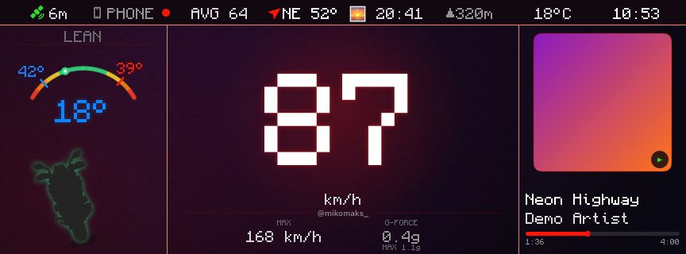 | 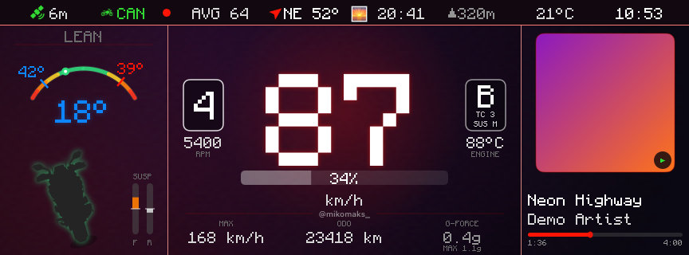 |
| GPS speed, lean from the phone, music | + gear, RPM, throttle, mode B / TC 3 / suspension M, coolant, odometer, suspension travel |

## ✨ Features

- **11 dashboard screens** switched with the handlebar joystick (you set the order in the app)
- **Lean angle** live with left / right records, g-force, heading, altitude, weather
- **Navigation** with Apple Maps on the dash — send a destination from Maps via "Share"
- **Music**: cover art, progress and a *Disco* screen with lyrics; joystick controls
- **Rides** record automatically once connected to the bike — GPS, lean, gear, RPM and songs;
  a ride library with map playback, CSV export, backup to iCloud Drive
- **Ride poster** for an Instagram story / post — configurable, with gears and the "ride's song"
- **Video**: your own videos on the dash (they keep playing with the phone locked)
- **CAN Terminal** — raw bus frames with live decoding
- **Games**: snake and sudoku 🐍 (when parked, please)
- **Dynamic Island** and Lock Screen with speed and gear
- Light and dark theme (▲▼▲▼ joystick shortcut), crisp pixel font rendered 1:1 with the display

## 🖼️ Screens

| | |
|:---:|:---:|
| 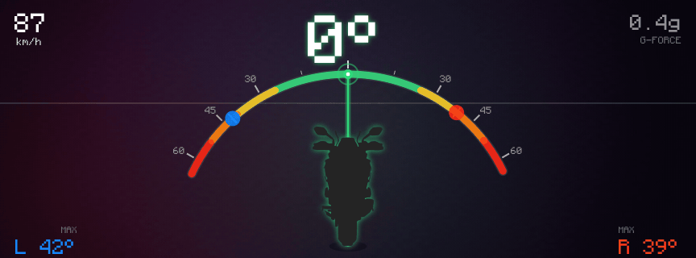 **Lean angle** | 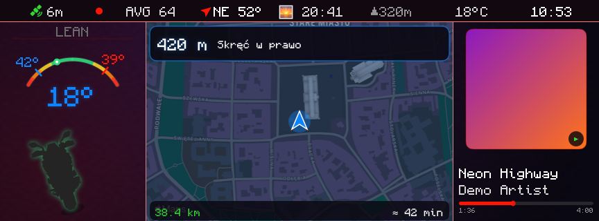 **Navigation + dashboard** |
| 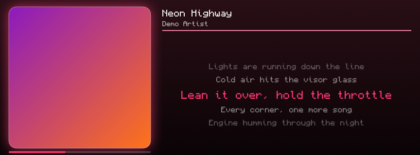 **Disco** — cover art and lyrics | 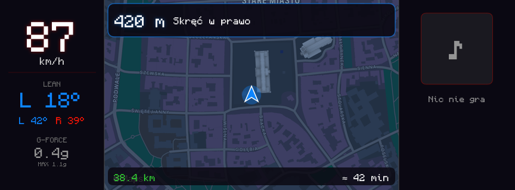 **Full-screen navigation** |
| 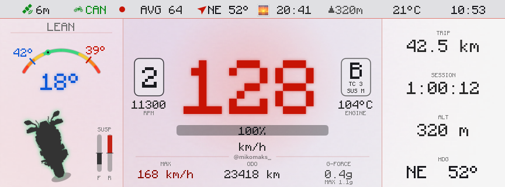 **Light theme** for full sun | 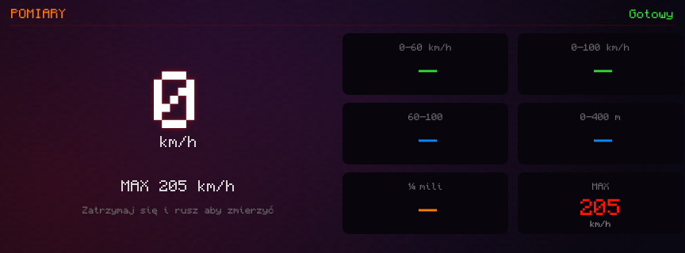 **Performance** 0–100, ¼ mile |
| 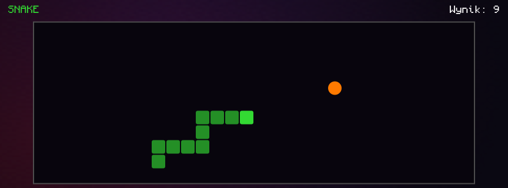 **Snake** | 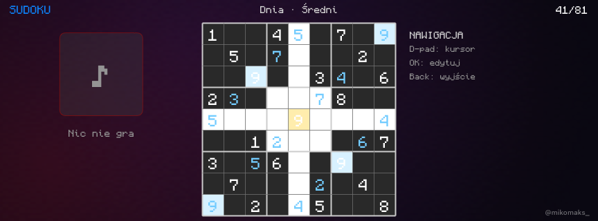 **Sudoku** |

### 🟩 CAN Terminal

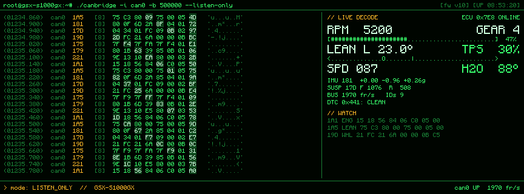

Frames from the bike's bus in `candump` style, changed bytes highlighted, decoded signals and
the stored fault code list on the right.

## 📲 The app

| Home | Ride | Poster | Settings |
|:---:|:---:|:---:|:---:|
| 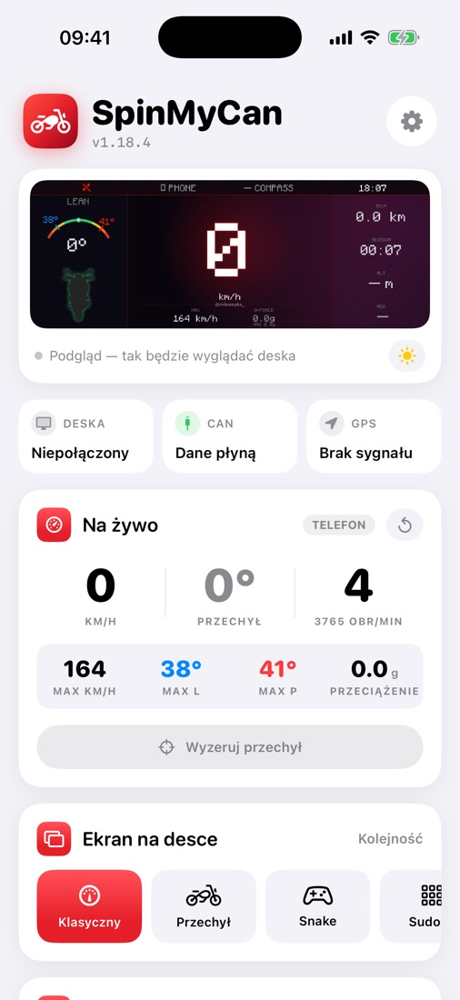 | 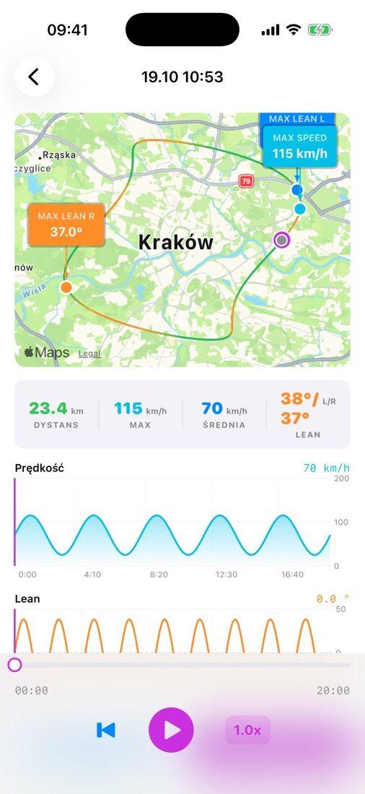 | 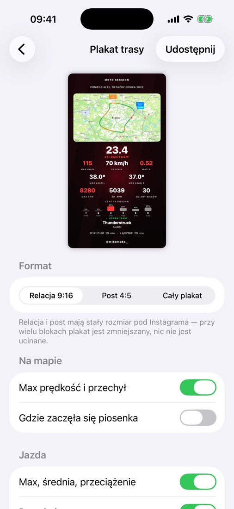 | 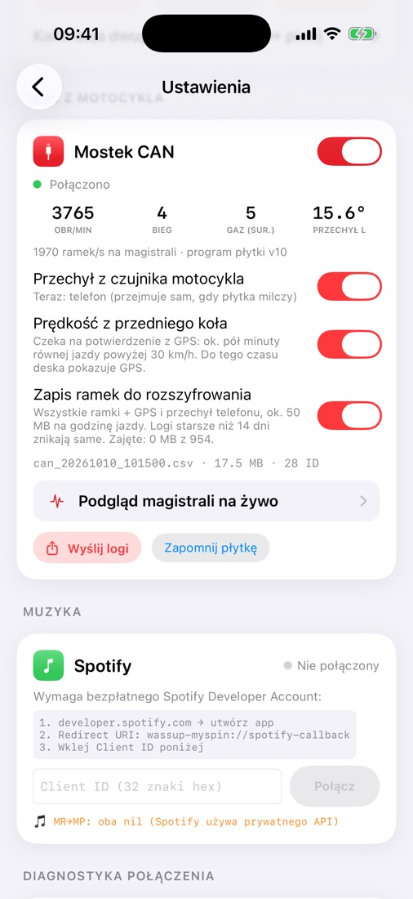 |

### Ride poster

  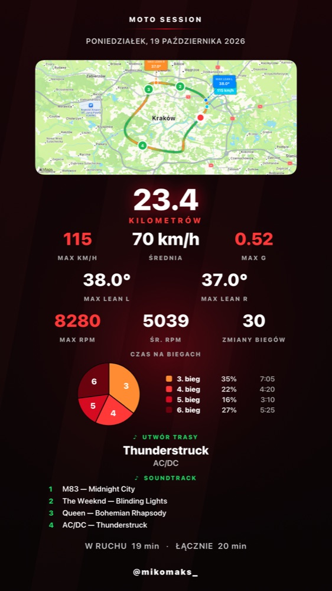
  &nbsp;
  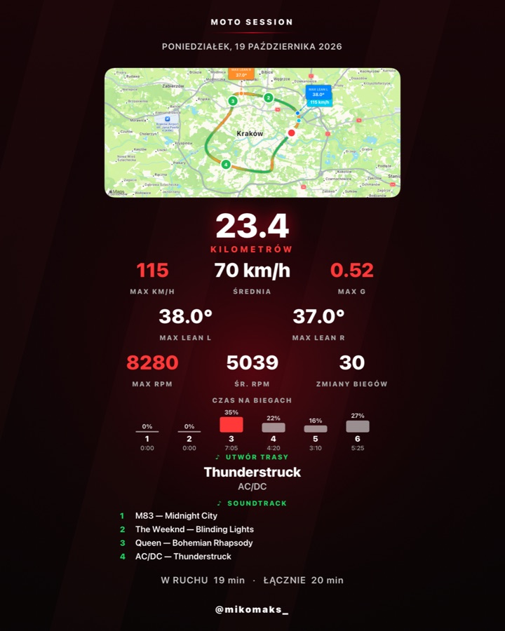

Map colored by speed, records, gears (bars or a pie chart with the time spent in each gear),
the song that played the longest and the ride's whole soundtrack. 9:16 story, 4:5 post or the
full-length poster.

## ⚙️ How it works

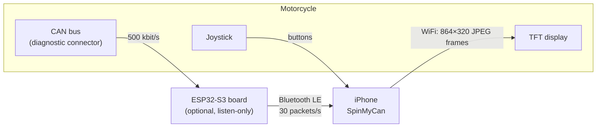

The phone draws every dashboard frame itself and sends it to the display as a finished image —
so the dash can look however you want. The handlebar joystick talks back to the phone and
switches screens, music, video and games.

## 🔌 CAN board (optional)

A [Waveshare ESP32-S3-RS485-CAN](https://www.waveshare.com/) plugged into the bike's diagnostic
connector. By default it **only listens** to the bus and streams telemetry to the phone over
Bluetooth; it updates wirelessly from the app (signed images). Firmware in
`firmware/can-ble-bridge/`.

<b>Decoded GSX-S1000GX signals</b> (full write-up in Polish: <code>tools/can/SYGNALY.md</code>)

| Signal | ID | Signal | ID |
|---|---|---|---|
| RPM, throttle, gear | `1A1` | Lean angle, coolant, clutch | `1A5` |
| Odometer, air temperature | `231` | Riding mode A / B / C | `331` |
| Traction control (per mode) | `335` | Load mode (SOLO / DUO…) | `1AD` |
| Damping H / M / S / U | `32D` | Suspension travel front / rear | `17D` |
| Wheel speeds | `19D` | Acceleration, 3 axes | `181` |
| Cruise control | `341` | Stored fault codes | `441` |

Every signal comes with a proof recording in `tools/can/dowody/`. For analysis there's
`tools/can/canlog.py` and a browser panel, `make can-panel` (live frames or a log, with the
GPS track on a map).

## ⚠️ Safety

- **Use at your own risk** — the software is provided "as is", without warranty ([LICENSE](LICENSE)).
- **Don't handle your phone while riding.** Watch the road, not the dash.
- The board only ever transmits on the bus during **diagnostics** (reading / clearing fault
  codes): parked only, engine off, one command at a time. Clearing a code **does not fix the
  fault** — if the warning light comes back, see a mechanic.
- Before plugging in, **check the pins with a multimeter** (the plug seen face-on is a mirror
  image of the socket), make sure the board and the bike share ground, and never short CAN-H
  to CAN-L — even a brief short can light up FI / E-SUS.
- Tampering with the electrical system may void the manufacturer's warranty.

## 🛠️ Building

iOS app and board

Requirements: macOS with Xcode 26, an iPhone on iOS 26, Python 3; PlatformIO for the board.

1. In Xcode set your own signing team for the `MySpin`, `ride_widget` and `share_extension`
   targets, and your own identifiers (`wassup.MySpin…`, `group.com.mikomaks.myspin`).
2. Simulator: `make sim-build`
3. Phone: `make install DEVICE_UDID=<UDID>` (UDID: `xcrun devicectl list devices`)
4. Board (optional): `make fw-key` (once — your own update signing key), then
   `make fw-flash` over USB, or `make fw-bundle` + `make install` (update from the app).

The built-in video for the "Video" screen is optional: `video/isle_of_man_tt.mp4` + `make video`
(ffmpeg) — or add your own videos in the app from Photos / Files.

The images in this README are made by the app itself: `README_SHOTS=1` in the simulator
(`MySpin/ReadmeMedia.swift`), and `tools/readme_media.sh` turns them into animations.

## 📜 Interoperability and licenses

The display communication format was determined solely to make an independently created program
interoperate with a device its owner lawfully possesses (Art. 6 of Directive 2009/24/EC;
Art. 75(2) of the Polish Copyright Act). This repository contains no Bosch or Suzuki code or
assets. The CAN signals were read from our own motorcycle.

- Code: [MIT](LICENSE)
- Monocraft font — © Idrees Hassan, SIL Open Font License 1.1 ([licenses/Monocraft-OFL.txt](licenses/Monocraft-OFL.txt))
