

  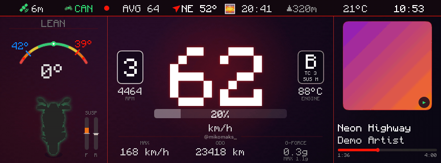

<h1 align="center">SpinMyCan</h1>

  <b>Własna deska na kolorowym TFT Suzuki GSX-S1000GX — prosto z iPhone'a.</b> 
  Przechył, prędkość, nawigacja, muzyka, nagrywanie tras… a z opcjonalną płytką CAN także
  obroty, bieg, tryby jazdy i zawieszenia, temperatury i przebieg prosto z szyny motocykla.

  
  
  
  
  
  

<a href="README.md">🇬🇧 English version</a>

> *An open-source iOS dashboard for the Suzuki GSX-S1000GX TFT (mySPIN-compatible protocol),
> with an optional ESP32 CAN-to-BLE bridge for live engine data. Works great with just the phone.
> Docs and code comments are in Polish.*

> [!NOTE]
> Niezależny projekt hobbystyczny — **niezwiązany z Robert Bosch GmbH (mySPIN) ani z Suzuki**,
> nie jest przez nie wspierany. Nazwy służą tylko do opisania, z czym projekt współpracuje.
> Grafiki w tym README są wyrenderowane przez apkę na **danych pokazowych**.

---

## 📱 Wystarczy sam telefon

**Płytka CAN jest dodatkiem, nie wymaganiem.** Bez niej apka działa w pełni: prędkość bierze
z GPS, przechył i przeciążenie z czujników telefonu w uchwycie (z kalibracją), a resztę —
nawigację, muzykę, nagrywanie tras, wideo, gry — robi sama. Płytka dokłada to, czego telefon
nie wie: obroty, bieg, gaz, tryby, temperatury, zawieszenie, przebieg i dokładny przechył
z czujnika motocykla.

| Sam telefon | Telefon + płytka CAN |
|:---:|:---:|
| 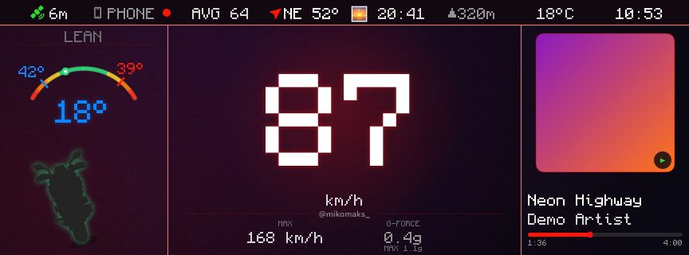 | 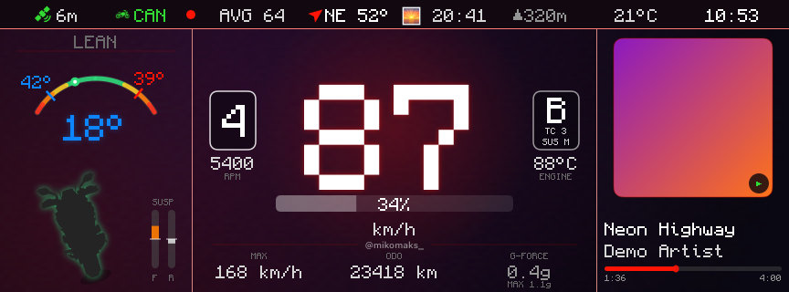 |
| prędkość z GPS, przechył z telefonu, muzyka | + bieg, obroty, gaz, tryb B / TC 3 / zawieszenie M, płyn, przebieg, ugięcie zawieszenia |

## ✨ Co potrafi

- **11 ekranów deski** przełączanych joystickiem z kierownicy (kolejność ustawiasz w apce)
- **Przechył** na żywo z rekordami lewo / prawo, przeciążenie, kurs, wysokość, pogoda
- **Nawigacja** z Apple Maps na desce — wyślij cel z Map przez „Udostępnij”
- **Muzyka**: okładka, postęp i ekran *Disco* z tekstem piosenki; sterowanie joystickiem
- **Trasy**: nagrywają się same po połączeniu z motocyklem — GPS, przechył, bieg, obroty
  i piosenki; biblioteka z odtwarzaniem na mapie, eksport CSV, kopia w iCloud Drive
- **Plakat trasy** do relacji / posta na Instagram — konfigurowalny, z biegami i „utworem trasy”
- **Wideo**: własne filmy na desce (grają też przy zablokowanym telefonie)
- **Terminal CAN** — surowe ramki szyny z dekodowaniem na żywo
- **Gry**: wąż i sudoku 🐍 (na postoju, proszę)
- **Dynamic Island** i ekran blokady z prędkością i biegiem
- Jasny i ciemny motyw (skrót ▲▼▲▼ na joysticku), ostra pikselowa czcionka 1:1 z wyświetlaczem

## 🖼️ Ekrany

| | |
|:---:|:---:|
| 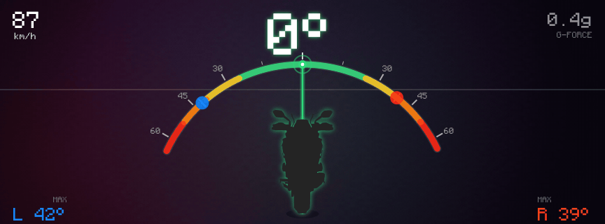 **Przechył** | 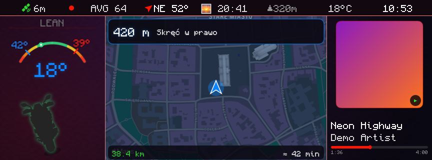 **Nawigacja + deska** |
| 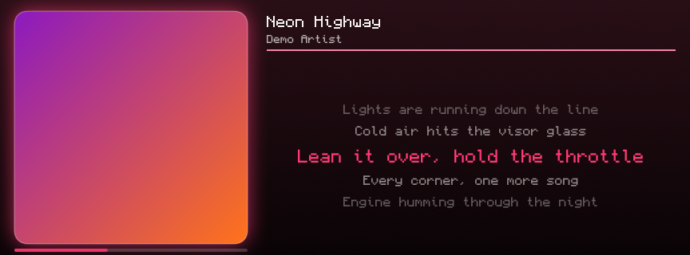 **Disco** — okładka i tekst | 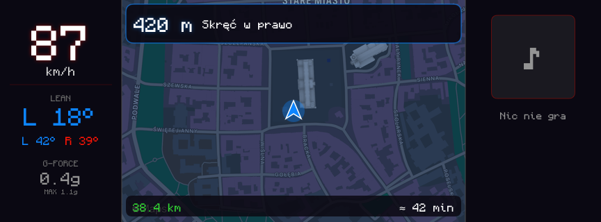 **Nawigacja** na cały ekran |
| 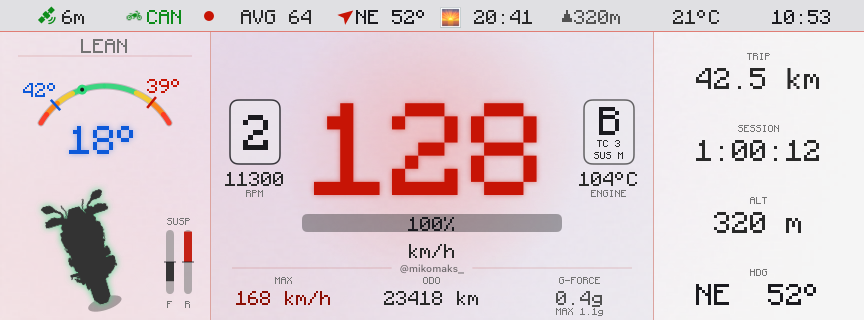 **Jasny motyw** na pełne słońce | 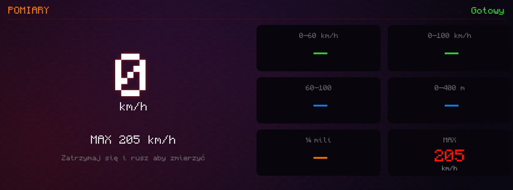 **Pomiary** 0–100, ¼ mili |
| 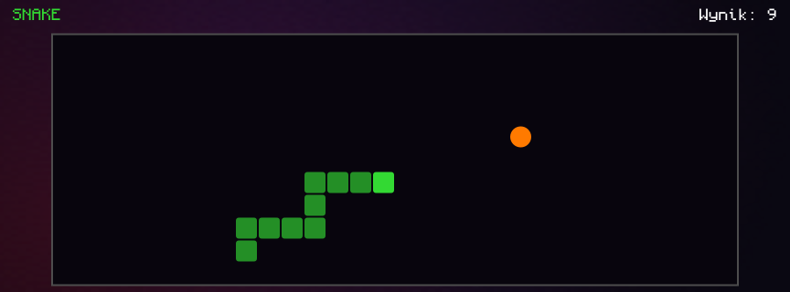 **Wąż** | 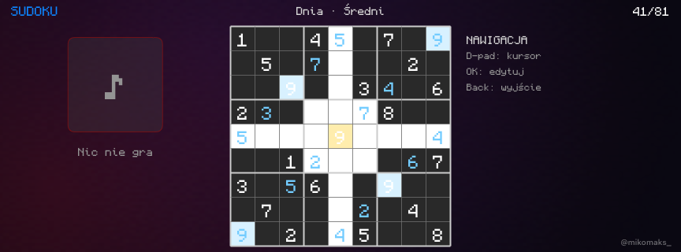 **Sudoku** |

### 🟩 Terminal CAN

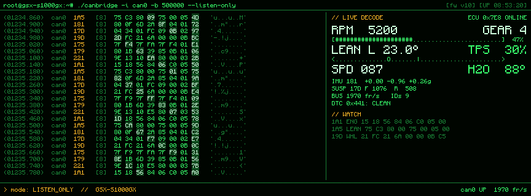

Ramki z szyny motocykla w stylu `candump`, zmienione bajty podświetlone, po prawej odczyt
sygnałów i lista kodów błędów.

## 📲 Apka

| Ekran główny | Trasa | Plakat | Ustawienia |
|:---:|:---:|:---:|:---:|
| 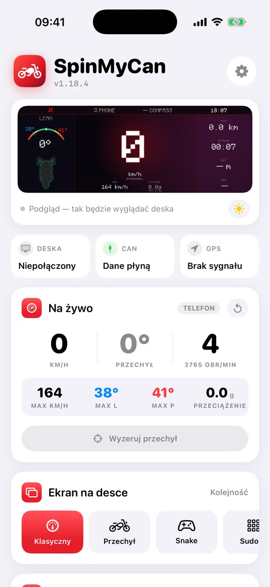 | 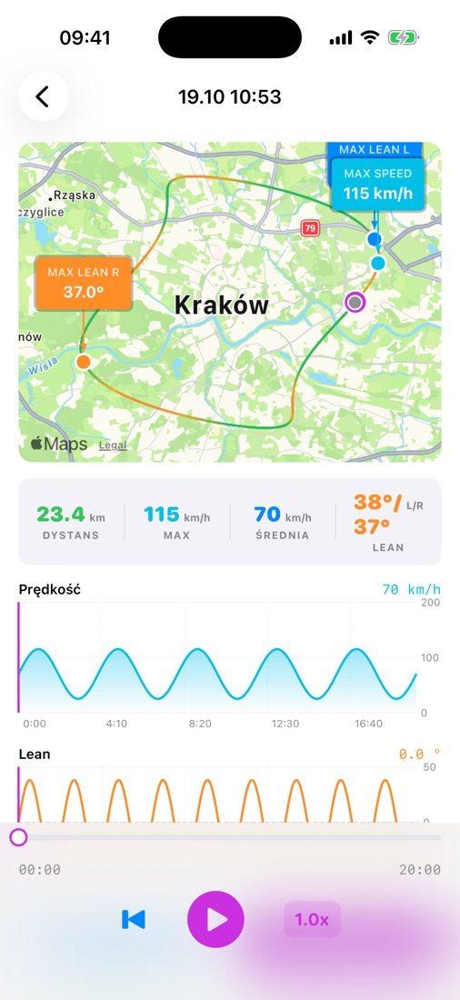 | 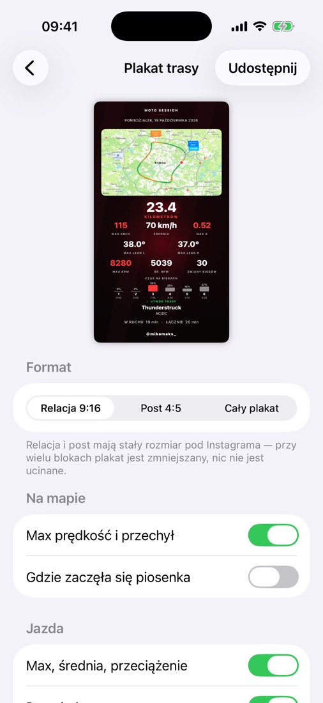 | 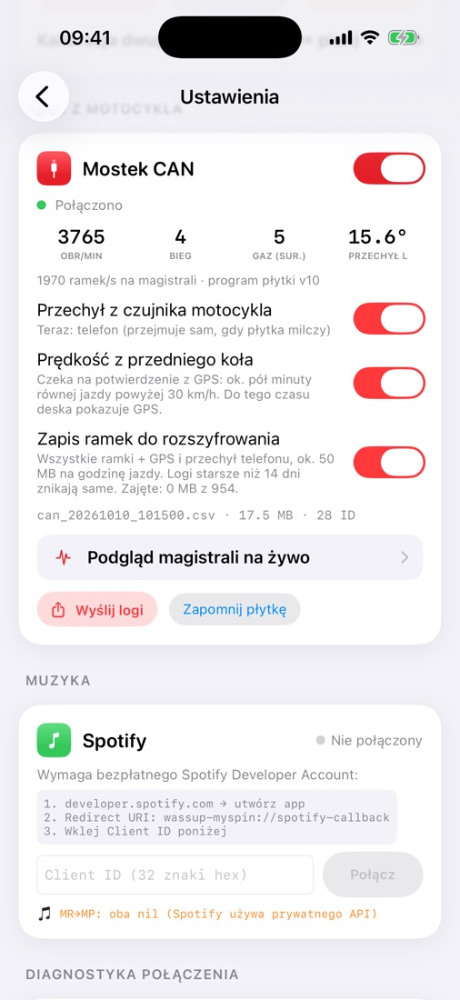 |

### Plakat trasy

  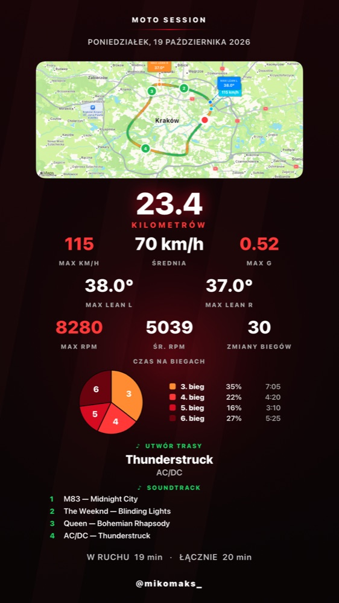
  &nbsp;
  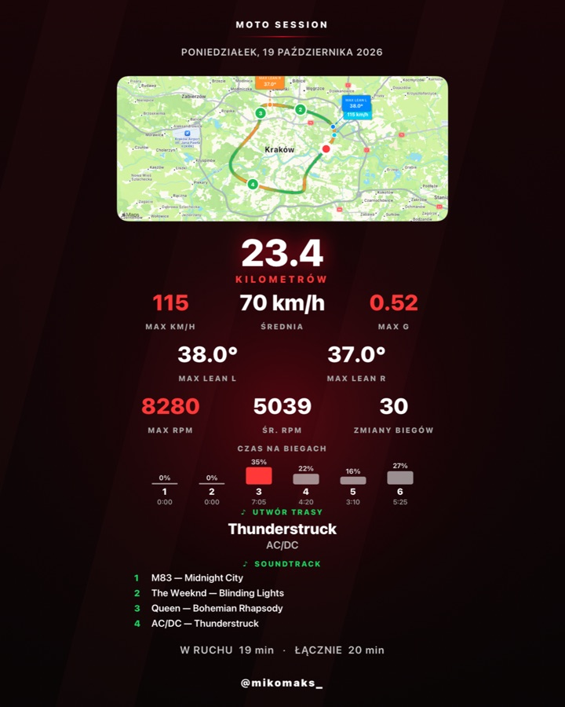

Mapa z kolorem prędkości, rekordy, biegi (słupki albo wykres kołowy z czasem na każdym biegu),
piosenka, która grała najdłużej, i cała ścieżka dźwiękowa trasy. Format relacji 9:16, posta 4:5
albo pełny plakat.

## ⚙️ Jak to działa

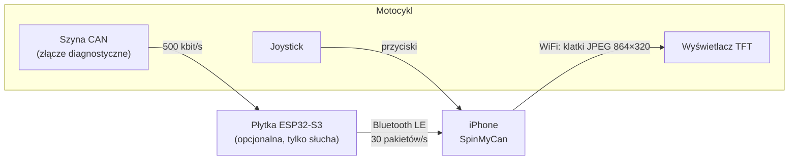

Telefon rysuje każdą klatkę deski sam i wysyła ją na wyświetlacz jako gotowy obrazek —
dlatego deska może wyglądać jak chcesz. Joystick z kierownicy wraca do telefonu i przełącza
ekrany, muzykę, wideo, gry.

## 🔌 Płytka CAN (opcjonalna)

[Waveshare ESP32-S3-RS485-CAN](https://www.waveshare.com/) wpięta w złącze diagnostyczne
motocykla. Domyślnie **tylko słucha** szyny i wysyła telefonowi telemetrię przez Bluetooth;
aktualizuje się bezprzewodowo z apki (podpisane obrazy). Program w `firmware/can-ble-bridge/`.

<b>Rozszyfrowane sygnały GSX-S1000GX</b> (pełny opis: <code>tools/can/SYGNALY.md</code>)

| Sygnał | ID | Sygnał | ID |
|---|---|---|---|
| Obroty, gaz, bieg | `1A1` | Przechył, płyn, sprzęgło | `1A5` |
| Przebieg, powietrze | `231` | Tryb jazdy A / B / C | `331` |
| Trakcja (każdy tryb osobno) | `335` | Tryb obciążenia (SOLO / DUO…) | `1AD` |
| Tłumienie H / M / S / U | `32D` | Skok zawieszenia przód / tył | `17D` |
| Prędkość kół | `19D` | Przyspieszenia 3 osie | `181` |
| Tempomat | `341` | Zapisane kody błędów | `441` |

Każdy sygnał ma nagranie-dowód w `tools/can/dowody/`. Do analizy: `tools/can/canlog.py`
i panel w przeglądarce `make can-panel` (ramki na żywo albo z logu, trasa GPS na mapie).

## ⚠️ Bezpieczeństwo

- **Używasz na własne ryzyko** — oprogramowanie jest „tak jak jest”, bez gwarancji ([LICENSE](LICENSE)).
- **Nie obsługuj telefonu w czasie jazdy.** Patrz na drogę, nie na deskę.
- Płytka wysyła cokolwiek na szynę wyłącznie przy **diagnostyce** (odczyt / kasowanie kodów
  błędów): tylko na postoju, z wyłączonym silnikiem, jedna komenda naraz. Skasowanie kodu
  **nie naprawia usterki** — jeśli kontrolka wraca, jedź do serwisu.
- Przed podłączeniem do złącza **sprawdź piny miernikiem** (wtyczka z naprzeciwka to lustrzane
  odbicie gniazda), zapewnij wspólną masę i nie zwieraj CAN-H z CAN-L — chwilowe zwarcie
  potrafi zapalić FI / E-SUS.
- Ingerencja w instalację elektryczną może naruszyć gwarancję producenta.

## 🛠️ Budowanie

Apka iOS i płytka

Wymagania: macOS z Xcode 26, iPhone z iOS 26, Python 3; dla płytki PlatformIO.

1. W Xcode ustaw własny zespół podpisu dla celów `MySpin`, `ride_widget`, `share_extension`
   oraz własne identyfikatory (`wassup.MySpin…`, `group.com.mikomaks.myspin`).
2. Symulator: `make sim-build`
3. Telefon: `make install DEVICE_UDID=<UDID>` (UDID: `xcrun devicectl list devices`)
4. Płytka (opcjonalnie): `make fw-key` (raz — twój klucz podpisu aktualizacji), potem
   `make fw-flash` po USB albo `make fw-bundle` + `make install` (aktualizacja z apki).

Film wbudowany w ekran „Wideo” jest opcjonalny: `video/isle_of_man_tt.mp4` + `make video`
(ffmpeg) — albo dodaj własne filmy w apce z Galerii / Plików.

Grafiki do tego README robi sama apka: `README_SHOTS=1` w symulatorze (`MySpin/ReadmeMedia.swift`), a `tools/readme_media.sh` składa z nich animacje.

## 📜 Współdziałanie i licencje

Format komunikacji z wyświetlaczem ustalono wyłącznie w celu współdziałania niezależnie
stworzonego programu z urządzeniem, które właściciel legalnie posiada (art. 6 dyrektywy
2009/24/WE; art. 75 ust. 2 ustawy o prawie autorskim). Repozytorium nie zawiera kodu ani zasobów
Boscha ani Suzuki. Sygnały CAN odczytano z własnego motocykla.

- Kod: [MIT](LICENSE)
- Czcionka Monocraft — © Idrees Hassan, SIL Open Font License 1.1 ([licenses/Monocraft-OFL.txt](licenses/Monocraft-OFL.txt))
