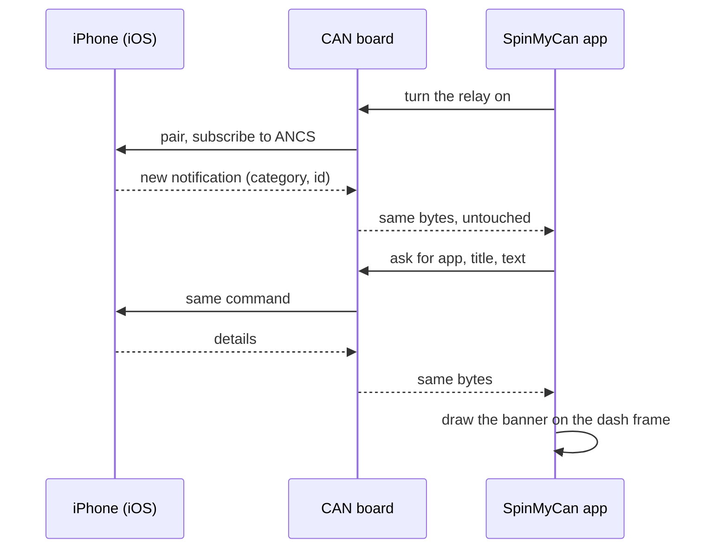

# Phone notifications on the dash and the quick menu

Calls and messages from the iPhone shown on the motorcycle display, plus a small settings
menu you can open with the joystick while riding.

Notifications need the optional CAN board with firmware **v12** or newer. They are
**experimental and off by default**: the board part has been built and its logic tested in the
app, but check it at your desk before relying on it on the road. The quick menu and the test
notification work with the phone alone.

> [!WARNING]
> Reading messages while riding takes your eyes off the road. The banner is short on purpose
> and the full text opens only when you press OK. Use "Calls and messages only", mute it from
> the quick menu when traffic is heavy, and read at a standstill.

## Turning it on

1. Update the board: **Settings → CAN bridge → Update the board to v12**.
2. In the same card turn on **Phone notifications**.
3. The phone asks to pair with `MySpin-CAN` — accept. iOS may also ask whether the accessory
   may show your notifications — allow.
4. The line under the switch says **Working**.

Pairing happens once. To see what it looks like without the board, press
**Show a test notification** — the banner appears on the dash (and in the preview in the app).

Turning the switch off is always enough to stop it: the board remembers nothing between
connections and starts the relay only when the app asks.

## On the dash

| Key | Banner visible | Quick menu open |
|---|---|---|
| **OK** | open the full text / fold it back | change the chosen setting |
| **◀** | close the banner | previous item |
| **▶** | — | next item |
| **▲ ▼** | — (they still change the screen) | close the menu |
| **OK twice** | — | opens the quick menu (when it is closed) |

- A banner slides in from the top and leaves by itself after 8 s (25 s when opened; an
  incoming call stays until the phone stops ringing).
- Several messages from the same person are shown together when opened; a badge counts the
  notifications waiting behind.
- A notification read or dismissed on the phone disappears from the dash too.
- Banner and menu are drawn over every screen, video included.

### Quick menu

**Press OK twice** on any screen. The menu takes the place of the top bar: the chosen item is
in the middle, ◀ ▶ move, OK changes it, ▲ ▼ close it; it also closes after 6 s without a key.

| Item | What it does |
|---|---|
| Theme | dark / light dashboard |
| Font | rounded / pixel |
| Notifications | on / muted (only when the feature is on) |
| Live background | on / off |
| Lean calibration | starts the calibration countdown |
| Next video · Exit game · End navigation | only on the screen they concern |

Because every screen now waits for a possible second click, a single OK reacts about half a
second later than before.

## How it works

An iOS app is not allowed to read the notifications of other apps. The phone does offer them
to a paired Bluetooth accessory through the **Apple Notification Center Service (ANCS)** — the
way third-party smartwatches get them. The board is that accessory.

- The **board is a relay**: it passes raw ANCS bytes both ways and interprets nothing
  (`firmware/can-ble-bridge/src/phone_notif.h`).
- The **app** parses them, asks for details, filters and draws
  (`MySpin/PhoneNotifications.swift`, `MySpin/DashOverlayPaint.swift`).
- Skipped: notifications the phone itself delivers silently, the ones that were already there
  when the board connected, and — with "Calls and messages only" — everything except calls,
  missed calls and message apps.

## Privacy and security

- **No keys in the repository.** Pairing is done by iOS and the board ("Just Works" with
  bonding); the keys are generated at pairing time and stay on the two devices.
- Notification text exists only in memory while the banner is shown. It is **never written to
  any log** — the link log records only the state of the relay.
- The board forwards the bytes only over the connection they came from: back to your phone.
- A paired board can receive all notifications the phone shares with accessories. To revoke:
  **Settings → Bluetooth → MySpin-CAN → (i) → Share System Notifications** off, or
  **Forget This Device**.

## Troubleshooting

| Line under the switch | What to do |
|---|---|
| Board not connected or its firmware is too old | connect the board; update it to v12 |
| Accept the pairing request on the phone… | unlock the phone and confirm the request |
| Pairing refused or failed | switch off and on; if it repeats, forget `MySpin-CAN` in Settings → Bluetooth and pair again |
| The phone does not share notifications with the board | Settings → Bluetooth → MySpin-CAN → (i) → turn on *Share System Notifications* |
| Nobody accepted the pairing | switch off and on, then confirm on the phone within 45 s |

After flashing the board over USB with a full erase the board forgets the pairing while the
phone still remembers it — forget the device on the phone and pair again.

Not there yet: answering or rejecting a call from the joystick, app icons, replies.

## References

- Apple Notification Center Service (ANCS) Specification — Apple Developer documentation
- Tests: `MySpin/FeatureSelfTest.swift` (`testNotifications`, `testOverlay`)
